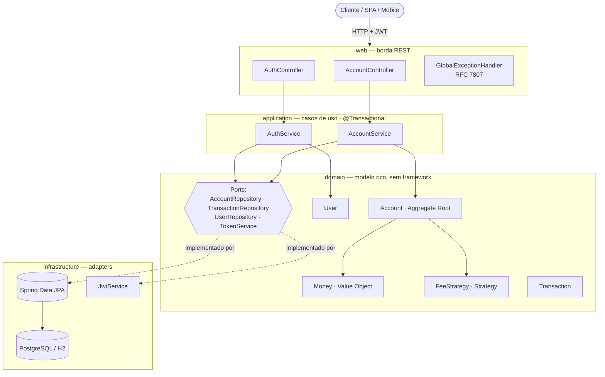
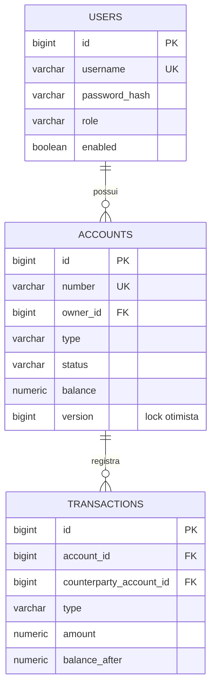
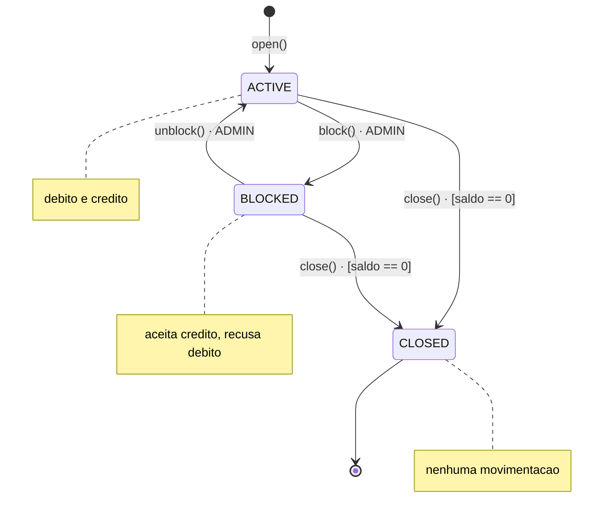
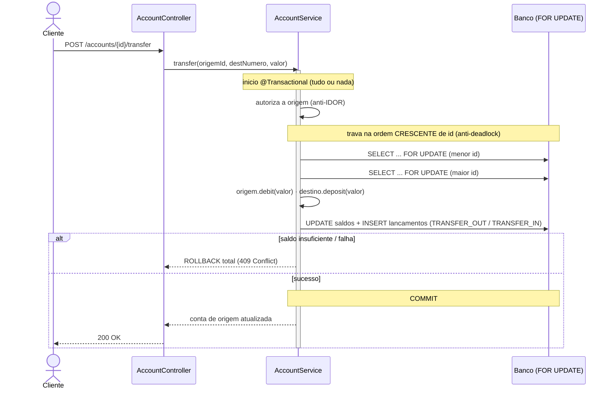

# Digital Bank API

> API bancaria enterprise em Java 17 + Spring Boot 3.4 — modelagem orientada a dominio (DDD), seguranca stateless com JWT e controle de concorrencia no caminho critico de movimentacao financeira.


---

## 1. Visao geral

Esta API nasceu de um exercicio de console da DIO (um unico arquivo `ContaTerminal.java` lendo dados via `Scanner`) e foi reescrita do zero como um sistema bancario de nivel enterprise. O objetivo e demonstrar, em codigo real e executavel, as competencias esperadas de uma vaga Fullstack Java: arquitetura limpa, modelo de dominio rico, seguranca aplicada (JWT, BCrypt, defesa contra IDOR) e — o ponto mais sensivel em um sistema financeiro — **integridade de saldo sob concorrencia**.

A aplicacao expoe operacoes de cadastro/login, abertura de contas, deposito, saque (com tarifa por tipo de conta), transferencia atomica entre contas e extrato paginado. Toda escrita financeira roda dentro de uma transacao com locking explicito; valores monetarios usam `BigDecimal` (nunca `double`).

---

## 2. Stack tecnologica

| Camada | Tecnologia |
|---|---|
| Linguagem | Java 17 |
| Framework | Spring Boot 3.4 — Web, Data JPA, Security, Validation, Actuator |
| Persistencia | PostgreSQL (perfil `postgres`) e H2 em memoria (perfil default) |
| Versionamento de schema | Flyway |
| Documentacao da API | springdoc-openapi (Swagger UI) |
| Autenticacao | JWT via JJWT (`io.jsonwebtoken`) + BCrypt |
| Testes | JUnit 5, AssertJ, Mockito e Spring Security Test (via `spring-boot-starter-test`) |
| Containerizacao | Docker (build multi-stage, usuario nao-root) + Docker Compose (com PostgreSQL) |
| Integracao continua | GitHub Actions — `mvn verify` a cada push / pull request |

> Build via Maven (`spring-boot-starter-parent` 3.4.1). PostgreSQL e H2 entram em `runtime`; a aplicacao sobe sem dependencias externas no perfil default (H2).

---

## 3. Arquitetura

Arquitetura **DDD com Hexagonal-lite (Ports & Adapters)**. O codigo e organizado por **bounded contexts** (`account`, `transaction`, `iam`) e, dentro de cada contexto, por camadas:

- **`domain`** — modelo rico: agregados, value objects, enums com comportamento, regras de negocio e excecoes de dominio. Nao depende de Spring.
- **`application`** — casos de uso (services) que orquestram o dominio e definem as fronteiras transacionais.
- **`infrastructure`** — adapters: implementacoes de repositorio (Spring Data JPA), seguranca JWT, seeders.
- **`web`** — controllers REST, DTOs e mappers (a borda HTTP, isolada do dominio).

Os **repositorios sao portas** declaradas no dominio (ex.: `AccountRepository`); os **adapters** sao interfaces Spring Data que as implementam na infraestrutura (ex.: `AccountJpaRepository extends AccountRepository, JpaRepository<Account, Long>`). O dominio depende da abstracao, nunca do framework.



### Modelo de dados



```
com.munique.bank
├── account
│   ├── domain            # Account (aggregate root), AccountStatus, AccountType,
│   │   ├── fee           #   FeeStrategy / CheckingFeeStrategy / SavingsFeeStrategy / FeeStrategyFactory
│   │   ├── repository    #   AccountRepository (porta)
│   │   └── exception     #   InsufficientFundsException, AccountNotActiveException, ...
│   ├── application       # AccountService (casos de uso), AccountNumberGenerator
│   ├── infrastructure    # AccountJpaRepository (adapter Spring Data JPA)
│   └── web               # AccountController, AccountMapper, DTOs
├── transaction
│   ├── domain            # Transaction, TransactionType, TransactionRepository (porta)
│   └── infrastructure    # TransactionJpaRepository (adapter)
├── iam
│   ├── domain            # User, Role, AuthenticatedUser, UserRepository (porta)
│   ├── application       # AuthService, TokenService
│   ├── infrastructure    # UserJpaRepository, DevDataSeeder, security/Jwt*
│   └── web               # AuthController, DTOs
└── shared
    ├── domain            # Money (value object monetario)
    ├── config            # SecurityConfig, OpenApiConfig
    ├── exception         # hierarquia base de excecoes de dominio
    └── web               # GlobalExceptionHandler (RFC 7807)
```

---

## 4. Padroes de projeto

| Padrao | Onde | Para que |
|---|---|---|
| **Strategy** | `FeeStrategy`, `CheckingFeeStrategy`, `SavingsFeeStrategy` | Politica de tarifa varia por tipo de conta sem `if/switch` espalhado |
| **Factory** | `FeeStrategyFactory`, `AccountType` (a enum resolve a estrategia) | Resolver a `FeeStrategy` correta a partir do tipo de conta |
| **State** | `AccountStatus` (`ACTIVE` / `BLOCKED` / `CLOSED`) | Cada estado decide as operacoes permitidas (debito/credito), blindando transicoes invalidas |
| **Value Object** | `Money` (`BigDecimal`, imutavel) | Representar dinheiro com seguranca — nunca `double` |
| **Aggregate Root / Repository** | `Account` + `AccountRepository` | Consistencia transacional e fronteira do agregado (DDD) |
| **DTO + Mapper** | `*Request` / `*Response` + `AccountMapper`, `TransactionMapper`, `UserMapper` | Desacoplar o contrato HTTP do modelo de dominio |
| **Port / Adapter** | `AccountRepository` (porta) + `AccountJpaRepository` (adapter) | Inverter a dependencia do dominio em relacao a infraestrutura |

O padrao **State** governa o ciclo de vida da conta — cada estado decide as operacoes permitidas e bloqueia transicoes invalidas:



---

## 5. Desafios de engenharia resolvidos

### Concorrencia e integridade de saldo
A invariante "o saldo nunca fica negativo" precisa sobreviver a requisicoes simultaneas. A defesa e em camadas:

- **Lock otimista** (`@Version` em `Account`) como defesa em profundidade contra *lost update*.
- **Lock pessimista** no caminho critico: `AccountRepository.findByIdForUpdate(...)` traduz para `SELECT ... FOR UPDATE` (`@Lock(LockModeType.PESSIMISTIC_WRITE)`), serializando as escritas concorrentes sobre a mesma conta. Saque, transferencia e mudancas de estado passam por ele.
- **Prevencao de deadlock em transferencias**: quando duas transferencias concorrem em sentidos opostos (A→B e B→A), adquirir os locks em ordem arbitraria pode travar o banco. Por isso os locks sao adquiridos **sempre em ordem crescente de id** (`firstId = min(...)`, `secondId = max(...)`), garantindo uma ordem global de aquisicao e eliminando o ciclo de espera.

O fluxo de uma transferencia atomica, com travamento ordenado:



### Transacoes atomicas
Cada caso de uso de escrita e anotado com `@Transactional`. Em uma transferencia, debito da origem e credito do destino (mais os dois lancamentos no extrato) ocorrem na **mesma transacao**: ou tudo persiste, ou tudo sofre rollback. Nao existe estado intermediario em que o dinheiro "sumiu" de uma conta sem chegar na outra.

### Precisao monetaria
`Money` encapsula um `BigDecimal` com escala fixa de 2 casas e arredondamento **HALF_EVEN** (arredondamento bancario), eliminando os erros de ponto flutuante que o `double` da versao original carregava. O tipo e imutavel e expoe operacoes de dominio (`add`, `subtract`, `isLessThan`, ...), nunca aritmetica solta.

### Seguranca (Secure by Design)
- **Hash de senha** com **BCrypt** (`BCryptPasswordEncoder`).
- **Autenticacao stateless via JWT** (Bearer token), sem sessao e sem CSRF — adequado a clientes SPA/mobile.
- **Autorizacao por papel** (`ADMIN` / `CUSTOMER`) com `@PreAuthorize` nos endpoints administrativos.
- **Defesa contra IDOR**: toda leitura/escrita de conta verifica a propriedade (`account.isOwnedBy(requester.id())`); um cliente so acessa as proprias contas (admin acessa todas).
- **Mitigacao de enumeracao de usuarios**: login com usuario inexistente devolve a **mesma mensagem generica** que senha invalida e executa um `passwordEncoder.matches(...)` contra um hash descartavel, equalizando o tempo de resposta (mitigacao de *timing attack*).
- **Erros RFC 7807** (`application/problem+json`) via `GlobalExceptionHandler`, **sem vazar stack trace** (`include-stacktrace: never`, CWE-209); erros inesperados sao logados no servidor e respondem 500 generico.
- **Validacao de entrada** com Jakarta Validation (`@NotNull`, `@DecimalMin`, `@Digits`, `@Size`) em todos os DTOs, mais limites de tamanho de header/corpo (anti-DoS).
- **Anti-brute-force**: o login conta falhas por `username + IP` e bloqueia (HTTP **429**) apos N tentativas dentro de uma janela (`LoginAttemptService`, O(1) por operacao).
- **CORS restrito**: origens explicitas (sem curinga), sem credenciais (o token vai no header `Authorization`, nunca em cookie).
- **Cabecalhos**: `X-Frame-Options: DENY` por padrao (anti-clickjacking); relaxado para `SAMEORIGIN` apenas em dev (console H2).

---

## 6. Como rodar

### Local — H2 em memoria (instantaneo, sem dependencias)
```bash
mvn spring-boot:run
```
- Swagger UI: `http://localhost:8080/swagger-ui.html`
- Console H2 (apenas dev): `http://localhost:8080/h2-console` — JDBC URL `jdbc:h2:mem:bank`, usuario `sa`, senha vazia.

### PostgreSQL (perfil `postgres`)
Tendo um PostgreSQL acessivel, ative o perfil e aponte o datasource por variaveis de ambiente:
```bash
SPRING_PROFILES_ACTIVE=postgres \
SPRING_DATASOURCE_URL=jdbc:postgresql://localhost:5432/bank \
SPRING_DATASOURCE_USERNAME=bank \
SPRING_DATASOURCE_PASSWORD=bank \
JWT_SECRET=uma-chave-secreta-com-pelo-menos-32-caracteres \
mvn spring-boot:run
```
O Flyway aplica as migrations (`db/migration`) e o Hibernate apenas **valida** o schema (`ddl-auto: validate`). No perfil `postgres` o console H2, o Swagger e o seeder de admin ficam desativados.

### Docker — aplicacao + PostgreSQL (um comando)
Os segredos ficam num arquivo `.env` (fora do versionamento). Copie o exemplo e suba a stack:
```bash
cp .env.example .env          # edite o JWT_SECRET para um valor proprio
docker compose up --build
```
Sobe um PostgreSQL 16 e a aplicacao no perfil `postgres`, com `depends_on`/healthcheck garantindo a ordem de inicializacao.

### Testes
```bash
mvn verify
```
Roda toda a suite (unidade + integracao + concorrencia) sem dependencias externas — os testes usam H2.

### Usuario admin (apenas dev/H2)
Fora do perfil `postgres`, o `DevDataSeeder` cria um administrador para facilitar a avaliacao:

```
usuario: admin
senha:   admin12345
```
> Credenciais default sao semeadas **somente** no perfil de desenvolvimento (H2) — nunca em producao.

---

## 7. Endpoints

Base URL: `http://localhost:8080`. Salvo indicacao, todas as rotas exigem `Authorization: Bearer <token>`.

| Metodo | Rota | Auth | Descricao |
|---|---|---|---|
| POST | `/api/auth/register` | Publico | Cadastra um cliente (role `CUSTOMER`) |
| POST | `/api/auth/login` | Publico | Autentica e retorna `accessToken` (JWT) |
| GET | `/api/auth/me` | Autenticado | Dados do usuario autenticado |
| POST | `/api/accounts` | Autenticado | Abre uma conta para o usuario autenticado |
| GET | `/api/accounts` | Autenticado | Lista as contas do usuario autenticado |
| GET | `/api/accounts/{id}` | Dono ou ADMIN | Consulta uma conta |
| POST | `/api/accounts/{id}/deposit` | Dono ou ADMIN | Deposita um valor |
| POST | `/api/accounts/{id}/withdraw` | Dono ou ADMIN | Saca um valor (aplica tarifa conforme o tipo) |
| POST | `/api/accounts/{id}/transfer` | Dono ou ADMIN | Transfere para outra conta de forma atomica |
| GET | `/api/accounts/{id}/statement` | Dono ou ADMIN | Extrato paginado |
| POST | `/api/accounts/{id}/block` | ADMIN | Bloqueia a conta |
| POST | `/api/accounts/{id}/unblock` | ADMIN | Reativa a conta |
| POST | `/api/accounts/{id}/close` | Dono ou ADMIN | Encerra a conta (exige saldo zero) |
| POST | `/api/accounts/{id}/monthly-closing` | ADMIN | Fechamento mensal: credita rendimento e cobra tarifa de manutencao |

---

## 8. Exemplos de uso (curl)

Fluxo validado fim a fim. As rotas de movimentacao usam o **id** da conta no path (`/api/accounts/{id}/...`); a transferencia usa o **numero** da conta de destino no corpo.

### 8.1. Registro
```bash
curl -X POST http://localhost:8080/api/auth/register \
  -H "Content-Type: application/json" \
  -d '{"username":"mario.andrade","password":"S3nh@Forte!2026","fullName":"Mario Andrade"}'
```

### 8.2. Login (captura o token)
```bash
TOKEN=$(curl -s -X POST http://localhost:8080/api/auth/login \
  -H "Content-Type: application/json" \
  -d '{"username":"mario.andrade","password":"S3nh@Forte!2026"}' \
  | sed -n 's/.*"accessToken":"\([^"]*\)".*/\1/p')
```
Todas as chamadas seguintes usam `-H "Authorization: Bearer $TOKEN"`.

### 8.3. Abrir conta (deposito inicial 1000.00)
```bash
curl -X POST http://localhost:8080/api/accounts \
  -H "Authorization: Bearer $TOKEN" \
  -H "Content-Type: application/json" \
  -d '{"type":"CHECKING","ownerName":"Mario Andrade","initialDeposit":1000.00}'
```

### 8.4. Depositar 250.00 (saldo: 1000.00 → 1250.00)
```bash
curl -X POST http://localhost:8080/api/accounts/1/deposit \
  -H "Authorization: Bearer $TOKEN" \
  -H "Content-Type: application/json" \
  -d '{"amount":250.00}'
```

### 8.5. Sacar 100.00 (Conta Corrente cobra tarifa de 1.00 → saldo 1250.00 − 101.00 = 1149.00)
```bash
curl -X POST http://localhost:8080/api/accounts/1/withdraw \
  -H "Authorization: Bearer $TOKEN" \
  -H "Content-Type: application/json" \
  -d '{"amount":100.00}'
```

### 8.6. Transferir 200.00 para outra conta (pelo numero)
```bash
curl -X POST http://localhost:8080/api/accounts/1/transfer \
  -H "Authorization: Bearer $TOKEN" \
  -H "Content-Type: application/json" \
  -d '{"destinationAccountNumber":"00012345","amount":200.00}'
```

### 8.7. Extrato
```bash
curl -X GET http://localhost:8080/api/accounts/1/statement \
  -H "Authorization: Bearer $TOKEN"
```

### 8.8. Erro de saldo insuficiente — `409 Conflict` (RFC 7807)
Saque/transferencia acima do saldo viola uma regra de negocio:
```json
{
  "type": "about:blank",
  "title": "Business Rule Violation",
  "status": 409,
  "detail": "Insufficient funds in account 00012345: balance 1149.00 < 5000.00"
}
```

### 8.9. Acesso a conta de outro usuario (IDOR) — `403 Forbidden` (RFC 7807)
```json
{
  "type": "about:blank",
  "title": "Forbidden",
  "status": 403,
  "detail": "Access to the requested account is forbidden"
}
```

---

## 9. Estrategia de testes

A piramide de testes valida cada camada com a ferramenta adequada:

| Nivel | Ferramentas | O que valida |
|---|---|---|
| **Unidade — dominio** | JUnit 5 + AssertJ | Regras puras de negocio sem framework: politicas de tarifa por tipo de conta (`FeeStrategyTest`), invariantes do agregado `Account` e do value object `Money` (saldo nao negativo, arredondamento HALF_EVEN) |
| **Unidade — seguranca** | JUnit 5 + AssertJ | Emissao/validacao de JWT, expiracao e assinatura (`JwtServiceTest`) |
| **Unidade — servico** | JUnit 5 + Mockito | Casos de uso do `AccountService` com repositorios mockados (autorizacao/IDOR, fluxo de tarifa, rollback) |
| **Integracao — web** | Spring Boot Test + MockMvc + Spring Security Test | Contrato HTTP fim a fim: codigos de status, payloads RFC 7807, regras de autorizacao por papel |
| **Concorrencia** | JUnit 5 + threads concorrentes sobre H2 | Saques/transferencias simultaneos provando que o saldo nunca fica negativo e que nao ha deadlock |

> **Todos os niveis acima estao implementados e passando** (`mvn verify`): dominio (`MoneyTest`, `AccountTest`, `FeeStrategyTest`), seguranca (`JwtServiceTest`, `AuthServiceTest`, `LoginAttemptServiceTest`), servico com Mockito (`AccountServiceTest`), integracao HTTP (`AuthControllerIT`, `AccountControllerIT`) e concorrencia (`ConcurrentWithdrawalIT`, que dispara 20 saques simultaneos e prova que o saldo nunca fica negativo). A suite roda no pipeline de CI a cada push/PR.

Para executar a suite:
```bash
mvn verify
```

---

## 10. Evolucao do projeto

**Antes** — exercicio de console (DIO): um unico arquivo `ContaTerminal.java`, leitura via `Scanner`, saldo em `double`, sem persistencia, sem testes, sem seguranca.

**Agora** — API REST enterprise: bounded contexts em DDD, modelo de dominio rico, value object monetario em `BigDecimal`, persistencia com JPA + Flyway, seguranca stateless com JWT/BCrypt, autorizacao por papel, defesa contra IDOR, tratamento de erros RFC 7807, documentacao OpenAPI/Swagger e — o nucleo do dominio financeiro — controle de concorrencia com lock pessimista e ordenacao de locks para impedir deadlock.

---

## 11. Autor e licenca

**Munique Feitoza**
- LinkedIn: https://www.linkedin.com/in/munique-feitoza-77034b231/
- GitHub: https://github.com/Munique-Feitoza

Copyright © 2026 Munique Feitoza. Distribuido sob a **GNU General Public License, versao 2.0 (GPL-2.0)**. Veja o arquivo [`LICENSE`](./LICENSE).
